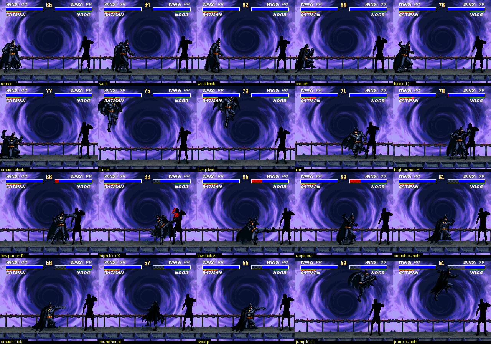
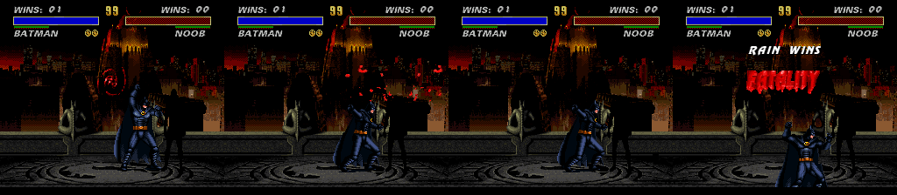
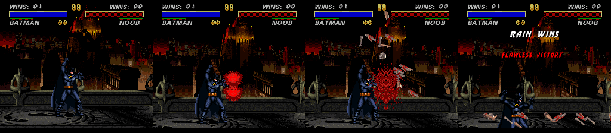
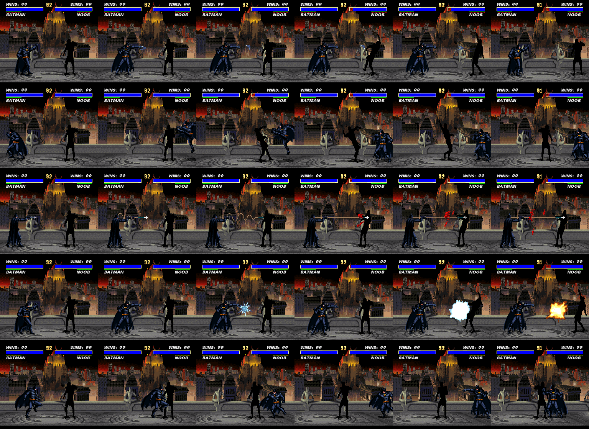
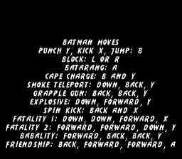

# Bat-Kombat: Batman in Ultimate Mortal Kombat 3 (SNES)

Batman, with his sprites from Batman Returns (SNES), is a playable fighter in Ultimate Mortal Kombat 3 (USA).
He takes Rain's slot (top-left cell of the fighter select grid).

**Play it:** `release/UMK3_Batman.zip` holds the patched ROM (8 MB, ExHiROM). Tested in snes9x only.



## What works

- Batman is drawn by the game's own sprite engine, so position, facing, scrolling, shadows, hit detection and
  animation timing are the game's. He works as player 1 and as player 2 (mirrored).
- 243 of Rain's body frames are replaced by 55 Batman poses: stance, walk, run, crouch, block, jumps, punches,
  kicks, uppercut, sweep, hit reactions, knockdown, get-up, dizzy and victory.
- Select screen: Batman portrait in Rain's cell, Batman standee. Health bar name reads BATMAN. The win banner reads BATMAN WINS.
- One-player tower: Batman's face. VS screen: Batman portrait. Mirror match: player 2 is a steel-grey Batman.
- Other fighters are untouched, including the other ninjas that share Rain's sprite set.
- Stress test: 12,000 frames of random input in one-player and two-player modes without a hang.

## Controls and move list

Batman uses the Batman Returns (SNES) buttons. The remap applies only to a pad whose fighter is Batman, and only
during a fight (`tools/batman_controls_patch.py`); everyone else keeps UMK3's buttons.

| Button | Batman Returns | Batman in UMK3 |
|---|---|---|
| Y | punch | punch (UMK3 high punch) |
| B | jump | jump (sent to the game as Up, so B + Left/Right jumps that way) |
| A | batarang | Batarang, no motion needed |
| L or R | cape block | block |
| B + Y | cape spin | Cape Charge |
| X | nothing | kick (UMK3 high kick), kept so the kick finishers and Spin Kick have a button |
| SELECT | nothing | nothing |
| D-pad | walk; Up/Down walk in depth | walk; Down crouches, Up jumps (UMK3 has no depth, and the specials need it) |

Directions are for Batman facing right; mirror them when he faces left.

| Move | Input | What it is in the engine |
|---|---|---|
| Batarang | A | Reptile's spit code, projectile redrawn as a batarang |
| Cape Charge | B + Y | Reptile's dash |
| Smoke Teleport | Down, Back, Y (also in the air) | Scorpion's teleport punch |
| Grapple Gun | Back, Back, Y | Scorpion's spear, fired from the grapple gun pose |
| Explosive | Down, Forward, Y | Ermac's fireball, redrawn as a spinning glass vial |
| Spin Kick | Back + X | Rain's roundhouse (unchanged) |
| Fatality 1 | Down, Down, Forward, X (close) | Ermac's uppercut decapitation |
| Fatality 2 | Forward, Forward, Down, Y (close) | Ermac's lift and slam |
| Babality | Forward, Back, Back, Y | Rain's (unchanged) |
| Friendship | Back, Forward, Forward, A | generic friendship code; Batman stands still under the banner |
| Stage fatality | Forward, Down, Forward, A | Rain's (unchanged) |






The same list is shown in the game for four seconds between the VS screen and the fight, whenever Batman is
in the match (`tools/move_list_patch.py`):



Rain's orb and lightning are removed. `tools/batman_moves_patch.py` documents the move table format.

## Collision, speed and timing

- Batman has his own collision boxes. UMK3's rule is box = drawn sprite, so each Batman frame's box is the full
  drawn Batman Returns pose, cape included. Batman Returns' own collision data was not found.
- Speed and timing follow Batman Returns, not UMK3 balance (`tools/batman_timing_patch.py`): walk 1.75 px per
  frame both ways with 8 frames per pose (was 3.25 forward, 2.25 back, 5 per pose); punch held out 4 frames;
  Batarang lunge 5 frames and recovery 4 (whole throw 34 frames shorter); block raise 4 frames; hit reaction
  25 frames (Batman Returns 24, was 17). Jump airtime is 38 frames (Batman Returns about 40), left as is.
  Damage is UMK3's.

## What is still borrowed

- Normal moves and damage are Rain's. The specials above are other ninjas' code.
- The rope, the explosive's blast and the hit effects use the original art. The batarang, grapple hook and vial are redrawn.
- Poses are matched by hand for the common actions and by silhouette shape for rarer ones (other ninjas'
  special moves, fatality frames). Some of those reuse the guard pose.
- Sounds: Batman's swings, the hits he takes and his Batarang and Grapple Gun throws use Batman Returns samples; Rain's
  voice is silenced (Batman does not speak in Batman Returns). Listen: deliverables/batman_sounds_before.wav and _after.wav. See `PLAN.md` for what is left and how to continue.

## Rebuild

Needs Python 3 with numpy and Pillow. The original ROM is in `Ultimate Mortal Kombat 3 (USA).zip`.

```
unzip "Ultimate Mortal Kombat 3 (USA).zip" -d build/
python3 -I tools/build_batman.py "build/Ultimate Mortal Kombat 3 (USA).sfc" build/UMK3_Batman.sfc
```

To change which pose replaces which frame, edit `EXPLICIT` in `tools/make_frame_map.py`, rerun it (it needs a
frame capture, see below), then rebuild. `art/batman_frame_map.json` also accepts per-frame `dx`/`dy` nudges and `flip`.

## How it works

1. **Sprite format.** `tools/umk3_sprites.py` documents and decodes the engine's format: a sprite id is
   `set << 9 | frame`; each set has a header pointing to a frame table, a bank table and a tileset table; a frame
   record lists 16x16 and 8x8 pieces with positions and tile references; tilesets may be raw 4bpp.
2. **New set.** `tools/build_batman.py` writes a Batman set with the same frame numbering as set 27 (the male
   ninja set), using raw tiles, into the free space of an 8 MB ExHiROM image (`tools/exhirom.py`).
3. **Hook.** The set lookup at `$88:A47A` calls a 72-byte routine at `$FF:DC6E`. When the object's fighter id
   (`$7E:52C8,y`) is 24 and the set is 27, it loads the Batman header. Nothing else in the engine changes.
4. **Limits respected.** A fighter owns 64 tiles of video RAM and a 45-piece buffer. The packer in
   `tools/batman_art.py` keeps every frame inside both, trimming dark cape-edge pixels first when it must.
5. **Palette.** Rain's 16-colour sprite palette at file `0x3EAFAF` is replaced (14 colours plus black).
6. **Moves.** `tools/batman_moves_patch.py` writes new special-move tables for fighter 24 in bank `$82`.
7. **Cosmetics.** `tools/roster_portrait_patch.py` and `tools/hud_name_patch.py`.

## Workflow for this kind of port

1. Get a debugger first (`tools/build_dbg_core.sh` builds a patched snes9x core; `tools/dbg_core.py` wraps it).
2. Log the ROM reads during one animation step and disassemble the reader (`tools/dis65.py`). That gives the format.
3. Write an offline decoder and prove it against the running game (`tools/capture_set_frames.py`: 355 of 380 frames match exactly).
4. Find the engine's limits before drawing anything: tile slots, piece buffers, banner memory.
5. Build the smallest end-to-end test (every frame = one pose) and look at a screenshot.
6. Record which frames each action uses (`tools/record_actions.py`), map poses, review side by side (`tools/review_map.py`).
7. Test both player sides, other fighters, round banners, and a long random-input run (`tools/action_sheet.py`).

## Files

- `tools/build_batman.py`, `batman_moves_patch.py`, `move_list_patch.py`, `batman_art.py`, `exhirom.py`, `make_frame_map.py`: the build.
- `tools/umk3_sprites.py`, `capture_set_frames.py`, `record_actions.py`, `review_map.py`, `action_sheet.py`, `dis65.py`: analysis and tests.
- `tools/libretro_harness.py`, `dbg_core.py`, `umk3_nav.py`: emulator harness, debugger, menu navigation.
- `art/batman_poses.tar.gz`: 100 Batman poses (a sprite rip of Batman Returns). `art/batman_frame_map.json`, `art/ninja_frames.json`: mapping data.
- `PLAN.md`: work plan and handoff. `tools/rig/`: emulator test rig (fight state, move filming, finisher filming).
- `tools/batman_sound_patch.py`, `extract_br_sounds.py`, `brr.py`: sounds (art/batman_sounds holds the extracted samples).
- `tools/vs_portrait.py`, `tower_face_patch.py`, `make_win_banner.py`: VS screen portrait and win banner.
- `Current_Work.md`: full history, including earlier approaches that did not work. `ROUTINES_UMK3.md`: earlier routine notes.
- Superseded, kept for history: `tools/make_batman_fighter.py` (sprite overlay hook), `tools/make_batman_reskin.py` (palette swap), `NEXT.md`.
